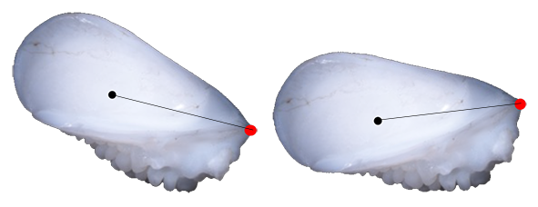
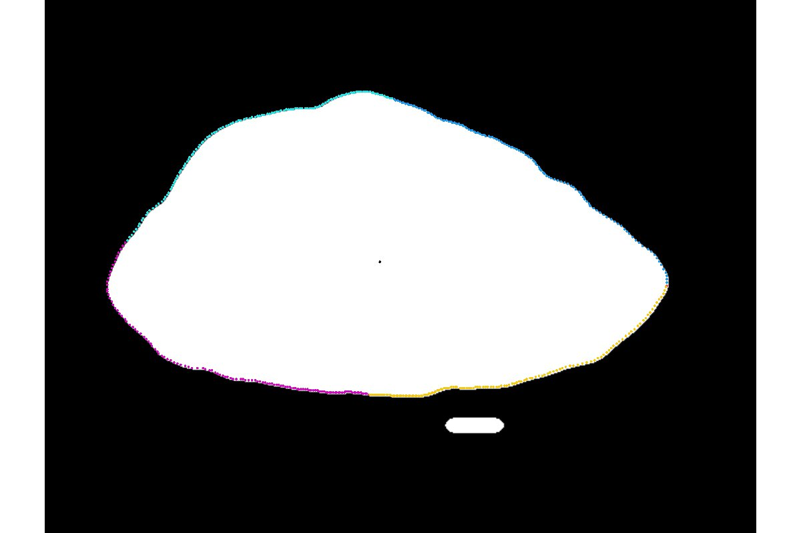
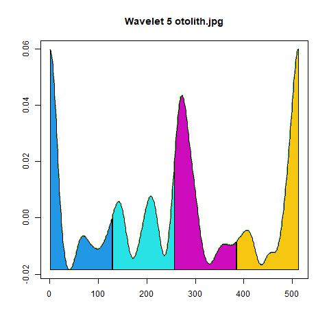

<style>
img {
  width: 100%;
  height: auto;
  display: block;
  margin: 1.5em auto;
}
</style>

```{r setup, include = FALSE}
knitr::opts_chunk$set(
  collapse = TRUE,
  comment = "#>"
)
```

## About this tutorial

This tutorial describes how to use the aforoR package to process images, extract otolith contours, and calculate shape descriptors including Elliptic Fourier Descriptors (EFDs), Wavelets, and morphometrics variables.

## 1. Image preparation and Standardizing

Otolith images should be placed with the *sulcus acusticus* facing upward, the *rostrum* to the right, and the dorsal margin at the top (Tuset et al., 2008; Lombarte and Tuset, 2015), according to its natural position.

"){width="21cm"}

During image acquisition, modeling clay can be helpful for otoliths with pronounced convexity.

")

The package determine automatically the initial contour point, which represents the maximum distance from the otolith centroid to this point locating to the right. The rostrum is usually the reference point; however, in otoliths where the rostrum is not clearly defined, it is preferable to select another homologous point, as illustrated in the following example.

{style="display:block; margin-left:auto; margin-right:auto;" width="25.9cm"}

### 1.1 Selecting the Contour Starting Point (`start_points`)

In `process_images()`, the `start_points` argument controls how the initial contour point (`0.0`, typically the rostrum) is selected across the folder without requiring extra parameters:

1. **Automatic (`start_points = "auto"`, default)**: Automatically selects the rightmost contour vertex ($\max(X)$) on every image. Compatible with both single-folder (`subfolder = FALSE`) and recursive (`subfolder = TRUE`) batch processing.
2. **Interactive Mouse Selection (`start_points = "manual"`)**: Sequentially displays each image with its extracted contour in cyan and the automatic candidate highlighted in yellow (`o`). Left-clicking with the mouse snaps the starting point to the nearest contour vertex (marked in red), while right-clicking or pressing `Esc` keeps the automatic candidate for that specimen.
3. **Custom Coordinate Matrix (`start_points = matrix_or_df`)**: Accepts a 2-column numeric `matrix` (or `data.frame`) of `(X, Y)` coordinates where `nrow(start_points)` must equal the total number of images in the folder. When using a custom matrix, folders must be processed individually (`subfolder = FALSE`).

```r
# Option A: Default automatic rostrum detection
process_images(folder = "path/to/images", start_points = "auto")

# Option B: Interactive mouse click on each otolith
process_images(folder = "path/to/images", start_points = "manual")

# Option C: Pre-defined N x 2 matrix of starting points (one row per image, subfolder = FALSE)
rostrum_coords <- matrix(c(1850, 920,
                           1790, 880), ncol = 2, byrow = TRUE,
                         dimnames = list(NULL, c("X", "Y")))
process_images(folder = "path/to/2_images", subfolder = FALSE, start_points = rostrum_coords)
```

### 1.2 Scale Calibration Modes (`detect_scale`)

The `detect_scale` argument provides three flexible ways to calibrate pixel-to-millimeter ratios:

1. **`detect_scale = "none"` (default)**: Uses the user-supplied `pixels_per_mm` numeric value (or outputs raw pixel units if omitted).
2. **`detect_scale = "auto"`**: Automatically segments the calibration scale bar from the background, computes its orientation and Euclidean pixel length, and marks its endpoints with red `x` marks in the diagnostic zonal visualization.
3. **`detect_scale = "manual"`**: Interactive calibration. Displays the image and prompts the user to click the two endpoints of the scale bar with the mouse. The exact Euclidean distance between the clicks is computed without snapping, calculating `pixels_per_mm` based on the specified physical length.

### 1.3 Adaptive Size Filtering (`min_area`)

The `min_area` argument controls the minimum object area required to be recognized as an otolith, filtering out dust, specks, and segmentation artifacts:

- **Adaptive Dynamic Scaling (`min_area = "auto"`, default)**: Calculates the threshold as 0.5% of the total image pixel area (min(5000, max(500, total_pixels * 0.005))). This dynamically adapts to both low-resolution photos (preventing false rejection of small specimens) and ultra-high-resolution macro photographs.
- **Fixed Area Threshold (`min_area = numeric`)**: Allows setting an explicit minimum area in square pixels (e.g. `min_area = 5000`).

Automatic contour detection is highly sensitive to illumination conditions. To minimize variability and ensure reliable results, we recommend acquiring all images under consistent lighting and background conditions (preferably uniform black color).

## 2. Setting up images

The package works by processing all supported image files (`.jpg`, `.jpeg`, `.png`, `.tif`, `.tiff`) within a specified folder. While we use sample images for this tutorial, full datasets of *Aphanopus carbo* and *A. intermedius* (as used in other vignettes) can be downloaded from Zenodo:

> [!NOTE]
> **Zenodo Dataset**: [Aphanopus Otolith Images](https://doi.org/10.5281/zenodo.18449478)

### 2.1 Folder Organization Best Practices

To ensure mathematically and biologically sound analyses, it is highly recommended to organize your image dataset structurally before running the package. **Place images of different species, populations, or stocks into separate, dedicated subfolders**. 

For example:
```text
Project_Images/
├── Aphanopus_carbo_Azores/
│   ├── otolith1.jpg
│   └── otolith2.jpg
└── Aphanopus_intermedius_Madeira/
    ├── otolith3.jpg
    └── otolith4.jpg
```

This structure is particularly critical if you intend to use the **Generalized Procrustes Analysis (GPA)** alignment (`procrustes = TRUE`). GPA calculates a global "consensus shape" for all specimens in the folder. If you mix highly divergent species in the same folder, the algorithm will attempt to find a non-biological average between them, distorting your morphometric signals. By processing species/stocks homogeneously in their respective folders, Procrustes operates optimally.

Furthermore, keeping datasets physically segregated simplifies data management. Although `aforoR` will generate separate output tables (`.csv`) for each folder, you can easily bind them together in R downstream, automatically assigning species or stock labels based on the directory names.

### 2.2 Setting up the working directory

First, let's look at where the example image is stored:

```{r image_setup}
library(aforoR)

# Locate the example image
image_path <- system.file("extdata", "otolith.jpg", package = "aforoR")

# Fallback if the package is not installed but we are running vignettes locally
if (image_path == "") {
  image_path <- file.path("../inst/extdata", "otolith.jpg")
}

# Create a temporary directory for processing
work_dir <- file.path(tempdir(), "aforo_tutorial")
if (dir.exists(work_dir)) unlink(work_dir, recursive = TRUE)
dir.create(work_dir)

# Copy the example image to the working directory
file.copy(image_path, file.path(work_dir, "otolith.jpg"))

cat("Working directory:", work_dir, "\n")
list.files(work_dir)
```

## 3. Processing images

The main function `process_images` handles the entire workflow:
1.  **Preprocessing**: Grayscale conversion, filtering, and binarization.
2.  **Contour Extraction**: Identifies the otolith boundaires.
3.  **Feature Calculation**: Computes distances, wavelets, and EFDs.
4.  **Morphometrics**: Calculates linear measurements and relative indices.

You can specify the scale of your images using the `pixels_per_mm` argument to get measurements in millimeters.

```{r process}
# Run the processing pipeline
# By default, threshold_method = "adaptive" (3-class Otsu), detect_scale = "none", and start_points = "auto" are used.
# Scale calibration options via detect_scale:
#   - detect_scale = "none" (default): uses fixed pixels_per_mm (or outputs in px)
#   - detect_scale = "auto": automatically detects the scale bar and marks its endpoints (x)
#   - detect_scale = "manual": prompts you to click the start & end points of the scale bar with the mouse
process_images(
  min_area = "auto",
  folder = work_dir,
  threshold_method = "adaptive",
  wavelets = TRUE,
  ef = TRUE,
  pixels_per_mm = 100,
  detect_scale = "none",
  start_points = "auto"
)
```

## 4. Examining Results

The function creates two subdirectories: `Polar` (Polar coordinates) and `Cartesian` (Perimeter coordinates).

### 4.1 Morphometric Measurements

A new file `MorphometricsEN.csv` is created containing geometric measurements.

```{r morpho_results}
morpho_file <- file.path(work_dir, "Polar", "MorphometricsEN.csv")
if (file.exists(morpho_file)) {
  morpho_data <- read.table(morpho_file, header = TRUE, sep = ";", dec = ".")
  knitr::kable(morpho_data, caption = "Morphometric Indices")
}
```

The measurements include:

*   **Area**: Area of the otolith ($mm^2$).
*   **Perimeter**: Perimeter length ($mm$).
*   **Length / Width**: Major and minor axis dimensions of the PCA-aligned bounding box ($mm$).
*   **Feret_Max**: Maximum Feret diameter (longest distance between any two boundary points; recommended robust measure of length) ($mm$).
*   **Feret_Min**: Minimum Feret diameter (minimum distance between parallel tangent lines; recommended robust measure of width) ($mm$).
*   **PCA_Angle**: Orientation angle of the major axis of inertia in degrees (normalized to [0, 180)).

### 4.2 Wavelet Coefficients

The wavelet analysis results are saved in multiple CSV files corresponding to different scales.

```{r wavelet_results}
wavelet_file <- file.path(work_dir, "Polar", "Wavelet_5EN.csv")
if (file.exists(wavelet_file)) {
  wave5 <- read.table(wavelet_file, header = FALSE, sep = ";", dec = ".")

  # Display first few columns
  knitr::kable(wave5[, 1:10], caption = "Wavelet Scale 5 (First 10 columns)")
}
```


### 4.3 Visualizations

The package automatically generates diagnostic images to verify the contour extraction and analysis zones.

#### Zonal Analysis
This diagnostic image overlays the extracted contour directly onto the original photograph, displaying the centroid (red `+`), the starting point/rostrum (red circle `o`), the four AFORO contour zones (`Zone 1` to `Zone 4`), and—when `detect_scale = "auto"` or `"manual"`—the calibration scale bar (green) with its exact physical endpoints (`x` in red).

{width="80%"}

#### Wavelet Transform
This plot visualizes the wavelet coefficients at a specific scale (default: scale 5). It highlights how different parts of the contour contribute to the shape complexity.

{width="80%"}


(Images are saved in the `Polar` folder).

